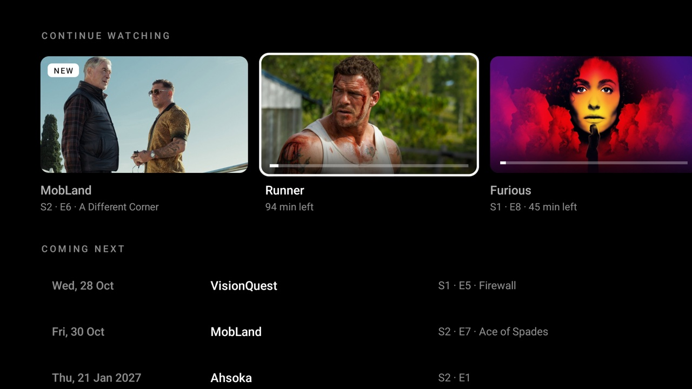

# Up next

Your Stremio shows on the TV: **Continue watching** (what you're in the middle of, the next episode of a show
you're following and new episodes of shows you'd caught up with) and **Coming next** (the next scheduled
episode of each show you follow, soonest first). OK opens Stremio on that episode. For the
[Clean Your TV](../../README.md) launcher it declares a [module card](../../docs/modules.md), so once you
answer **Show card** its tile reads "Up next · Your shows" with a violet glow; on any other Android TV home it
is an ordinary app.



- **Connect once** with a QR code: scan it with your phone (or open the short link) and log in to Stremio
  there, so there's no typing with the remote. **Disconnect Stremio** at the bottom of the page logs out.
- **Continue watching** follows Stremio's own rules: titles you've started, newest first, with the time left
  and a progress bar. A show you finished an episode of moves on to the next one (badge *Next*), and a show
  you'd caught up with gets its new episodes (badge *New*) for two months.
- **Coming next** lists shows watched in the last four months or kept in your library.
- Episode details (names, release dates, stills) come from Cinemeta, the metadata service Stremio itself
  uses, so next and new episodes need an IMDb id (most shows have one).
- It reads Stremio only while the page is on screen: when it opens, and again on return if the last read is
  more than 30 seconds old. The last lists are kept, so the page shows at once, also offline.
- English and Catalan; dates follow the app's language. On Android 13 and later the language can be set
  for this app alone (`adb shell cmd locale set-app-locales io.github.quicodomingo.continuewatching --locales ca`).

## Permissions

| Permission | Why |
|---|---|
| `INTERNET` | Stremio's API (the QR login and your library), Cinemeta (episode lists) and the artwork. |

That is all. What is sent: your Stremio session key to `api.strem.io`, to read your library, and show ids to
Cinemeta. The session key stays in the app's own storage (backups are off) until you disconnect. No
telemetry, no ads, no background service; the login code is checked every 3 seconds only while the QR code is
on screen, for up to 10 minutes.

The app also declares that it opens `stremio://` links (a `<queries>` entry), so Android 11 and later let it
hand an episode to the Stremio app. Without Stremio installed, OK shows a short message instead.

## Build and install

JDK 17 and Android SDK platform 34 with build-tools 34.0.0, as for the launcher:

```bash
cd addons/continue-watching && ./gradlew assembleRelease
TV_HOST=<tv ip> ../../tools/venv/bin/python -I ../../tools/tv.py --push app/build/outputs/apk/release/app-release.apk /data/local/tmp/addon.apk
TV_HOST=<tv ip> ../../tools/venv/bin/python -I ../../tools/tv.py 'pm install -r /data/local/tmp/addon.apk; rm -f /data/local/tmp/addon.apk'
```

Press Home: the launcher asks once whether to show the card. Change the answer later by holding OK on
Settings, then Module cards.

The release build is signed with the debug key so it installs over ADB like the launcher. Sign your own builds
with your own key if you hand them out; the launcher pins its Show answer to the signing key.

## Tested on

Homatics Dongle G 4K, Google TV / Android 14: the QR login, both lists, the D-pad through the page, OK into
Stremio, the card prompt and the card in the launcher's grid, English and Catalan.

## Maintainer

[@quicodomingo](https://github.com/quicodomingo)
