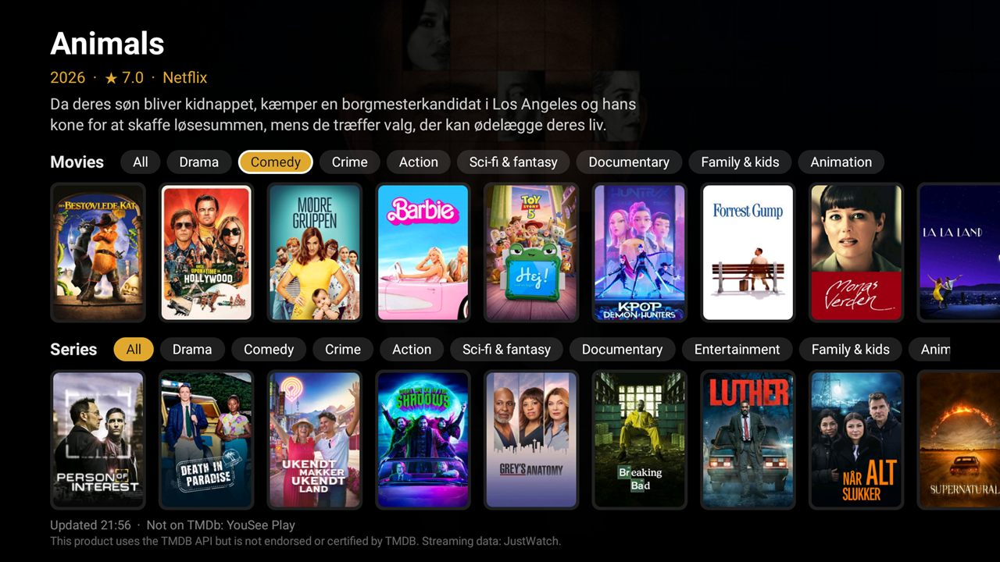

# Forslag

What is included in your own streaming subscriptions right now, on one Android TV screen.



*Forslag* is Danish for "suggestions". The app shows a row of movies and a row of series, most popular first,
mixed from each of your services in turn. Each row has genre tabs: All, Drama, Comedy, Crime, Action,
Sci-fi & fantasy, Documentary, Entertainment (series), Family & kids and Animation. Focus a title to see its year,
rating, plot and which of your services has it. Press OK to open it: Netflix, Disney+, DRTV and Viaplay open the
title itself where there is a link to it, and the other services open at their home screen.

It is an ordinary Android TV app (Android 8 and later), and it also declares a module card for the
[Clean Your TV](https://github.com/Gathin23/cleanyourtv) launcher, so it can sit in that launcher's dock
(label **Forslag**, caption *Film og serier*).

Its home is [github.com/modist/forslag](https://github.com/modist/forslag); issues and changes go there.

## Where the data comes from

| Source | What for |
|---|---|
| [TMDb](https://www.themoviedb.org/) | Most titles, plots, posters and genres; which subscription has what comes from JustWatch through TMDb. This product uses the TMDB API but is not endorsed or certified by TMDB. |
| DRTV and Viaplay | Their own catalogues, for DR's and Viaplay's titles and links. Both APIs are undocumented and unofficial (see [Limits](#limits)). |
| [Wikidata](https://www.wikidata.org/) (CC0) | The Netflix and Disney+ ids that open a title directly. |

Every source is free and needs no sign-in. TMDb needs a free API key of your own.

## Set up

1. Make a free TMDb account and ask for an API key at <https://www.themoviedb.org/settings/api>. Either the
   v3 "API Key" or the v4 "API Read Access Token" works.
2. Put it in `local.properties` in the project folder. Git ignores that file, so the key stays out of the repo.

   ```properties
   sdk.dir=/path/to/Android/Sdk
   tmdb.key=<your key>
   ```

   Or set `TMDB_KEY` in the environment when you build.
3. Pick your services in [`app/src/main/res/values/config.xml`](app/src/main/res/values/config.xml), one line
   per subscription, in the order their titles are mixed:

   ```xml
   <item>Netflix|com.netflix.ninja</item>
   <item>HBO Max,Max|com.wbd.stream</item>
   <item>drtv:DRTV|dk.dr.tvplayer</item>
   <item>viaplay:Viaplay|com.viaplay.android</item>
   ```

   Each line is the service's name on TMDb, then `|` and the Android TV app's package. Several names,
   separated by commas, cover a renamed service (TMDb calls TV 2 Play just `TV 2`), and a number is read as a
   TMDb provider id. `drtv:` and `viaplay:` take that service's titles from its own catalogue instead of TMDb.
   A name TMDb does not know is shown in the status line at the bottom of the screen, so you can correct it.

### Outside Denmark

Set `region` (a country code such as `SE` or `GB`) and `language` (such as `sv-SE`) in the same file, and list
your own services. The `drtv:` and `viaplay:` lines are Danish catalogues: remove them, or use a plain
`Viaplay|com.viaplay.android` line to take Viaplay's titles from TMDb.

## Build and install

You need JDK 17 and Android SDK 34.

```bash
./gradlew --no-daemon testReleaseUnitTest lintRelease assembleRelease
adb install -r app/build/outputs/apk/release/app-release.apk
```

Without the `adb` binary, the Clean Your TV repo's `tools/tv.py` does the same
(`--push` the APK to `/data/local/tmp`, then `pm install -r`; see that repo's
[addons/README.md](https://github.com/Gathin23/cleanyourtv/blob/main/addons/README.md)). With the Clean Your TV
launcher, press Home: it asks once whether to show the card. Answer Show card.

The release build is signed with the debug key, as the Clean Your TV launcher is. Your TMDb key is compiled
into the APK, so keep the APK to yourself: anyone who wants it builds their own with their own key.

## Permissions

| Permission | Why |
|---|---|
| `INTERNET` | Lists from `api.themoviedb.org` and posters from `image.tmdb.org`; each request sends only the region, language, genre, provider or title ids and your key. DRTV's lists from `production.dr-massive.com`, with posters from `prod95-static.dr-massive.com`. Viaplay's most popular and genre pages from `content.viaplay.dk`, with posters from `i-viaplay-com.akamaized.net`. One query per row to `query.wikidata.org` with the TMDb ids of the titles on Netflix and Disney+. None of these gets a sign-in or anything about you. |
| `<queries>` for launcher activities | To find and open the streaming app a title is on. Nothing is read from other apps. |

No background service, no telemetry, no ads, no account. Answers and posters are cached in the app's cache
folder for six hours (`cache_hours` in `config.xml`); opening the app again within that time sends nothing.
When a source can't be reached, the last answers are shown.

## Limits

- **The first load is slow.** TMDb's subscription filter also lets through titles a service only rents or
  sells (on Viaplay, 18 of the top 20 "subscription" movies were rentals), so each TMDb title's availability is
  checked before it is shown. A first load sends about 150 small requests and took about 50 seconds on the test
  TV. After that the cache answers, and a genre tab takes a few seconds the first time it is chosen.
- **DRTV and Viaplay use unofficial APIs.** They are the services' own, but undocumented, and can change
  without notice. If one fails, the rows simply have no titles from it.
- **DRTV in the genre tabs.** DR's lists are not by genre, so a tab keeps the DR titles DR tags with it; in the
  narrower genres there are few.
- **Opening a title directly** works on Netflix and Disney+ only when Wikidata has the service's id for the
  title: most well-known titles, few new ones. HBO Max's ids on Wikidata are in an old format the app no
  longer opens, and TV 2 Play and YouSee have none, so those open at their home screen. Netflix and Disney+
  ask for a profile first when they were not already running.
- **Quality filter.** Titles with fewer than 50 TMDb votes are left out (`min_votes`), which keeps out titles
  that are popular elsewhere but unknown here.
- **Freshness.** TMDb's availability data is JustWatch's and can lag a day or two behind a service's catalogue.
  Plots are in the configured language where TMDb has one, and empty otherwise.

## Tested on

Philips 2021/22 UHD Android TV (PH1M_EA_9970A), Android 11, with the Clean Your TV launcher: the rows,
posters, D-pad, genre tabs (Comedy movies, Crime series) and the module card. OK opened the title itself on
DRTV, on Viaplay and on Netflix while Netflix was already running, and HBO Max at its home screen. Disney+
opened the title from a link of the same form sent by hand.

## Licence

[MIT](LICENSE), by Morten Steensgaard ([@modist](https://github.com/modist)).
